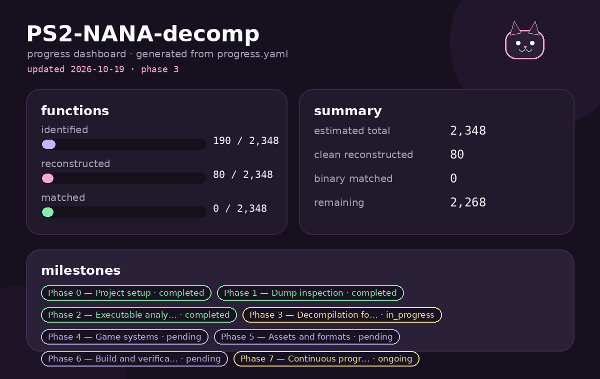

<div align="center">

```javascript
 /\___/ ( o.o )
  > ^ <
```

# PS2-NANA-decomp

**a soft little decompilation project for a very specific PlayStation 2 game**

</div>

## 🌸 about

```yaml
project: PS2-NANA-decomp
game: Nana (Japan)
serial: SLPM_659.14
platform: PlayStation 2 / Emotion Engine
compiler: Metrowerks CodeWarrior 2.4.1.01
language: C
status: active reverse engineering
matching: structural / behavioral first, byte matching later
```

This repository documents and reconstructs the main EE executable of *Nana*
for PlayStation 2. The original binary is stripped, statically linked, and
built with CodeWarrior, so the project focuses on readable C, symbol recovery,
control-flow reconstruction, and behavior preservation.

It is part software archaeology, part compiler behavior study, and part
"please let the scheduler make sense today."

## 🧁 legal note

This project **does not contain**, distribute, or ask for:

- game ROMs, ISOs, or executable dumps;
- copyrighted assets, audio, textures, or packages;
- Sony SDK files or proprietary toolchain material.

Analyze your own personal dump. Keep it local. Do not commit it.

## 🗺️ what lives here

```text
PS2-NANA-decomp/
├── AGENTS.md             # operational rules for humans + AI assistants
├── TODO.md               # human-readable milestone mirror
├── progress.yaml         # machine-readable progress source
├── docs/                 # ELF, overlays, disc map, formats, environment
├── notes/analysis/       # evidence notes and codegen observations
├── src/                  # reconstructed C sources
│   ├── common/           # EE types, syscall notes, shared definitions
│   ├── game/             # game loop, modes, scene, pad, sound scheduler
│   ├── render/           # display/frame helpers
│   └── system/           # startup, time, hooks, random
├── symbols/              # recovered addresses, names, sizes, status
└── tools/                # local analysis/progress helpers
```

## 🧠 current technical focus

Right now the project is deep in the **sound / scheduler core**:

- task queue wrappers;
- intrusive allocator;
- deferred-job lifecycle;
- scheduler init and subsystem context setup;
- memory helpers (`memmove`, `memset`, `strcpy`, `strncpy`);
- Ghidra symbol cleanup and CodeWarrior codegen cataloging.

The matching strategy is deliberately pragmatic:

1. reconstruct observable behavior in clean C;
2. preserve addresses, call order, globals, and side effects;
3. compare against Ghidra/rizin;
4. only then think about instruction-level matching.

## 📈 progress snapshot

<p align="center">

</p>

```yaml
estimated_total_functions: 2348
clean_reconstructed: 90
binary_matched: 0
phase: 3
phase_name: Decompilation foundation
```

The progress image is auto-generated on every push from `progress.yaml`.
Numbers are still estimates until the final Ghidra boundary export replaces
the rizin-based inventory.

## 🛠️ workflow

- Work from a private local dump.
- Keep the original dump read-only.
- Reconstruct one function or one coherent family at a time.
- Use evidence headers in source files.
- Mark functions as `RECONSTRUCTED` until verified.
- Update `TODO.md` and `progress.yaml` when progress changes.
- Do not commit ISOs, ELFs, SDK files, or generated binary outputs.

Useful local tools:

- Ghidra
- rizin + rz-ghidra
- binutils / readelf
- PCSX2 for future behavioral checks
- ps2dev toolchain for future build experiments

## 🍥 project status

Phase 3, *Decompilation foundation*, is active.

The repo is not yet buildable, and that is intentional for now. The current
priority is reconstructing enough verified structure to make a future build
and verification pass meaningful.

## 🌙 next steps

- solve the custom `$t0-$t3` calling convention used by scheduler internals;
- finish subsystem init dependencies;
- export reliable Ghidra function boundaries;
- continue replacing `extern` stubs with verified bodies;
- eventually prepare a buildable reconstruction target.

<div align="center">

*low-level code, soft documentation, tiny steps every day*

</div>
